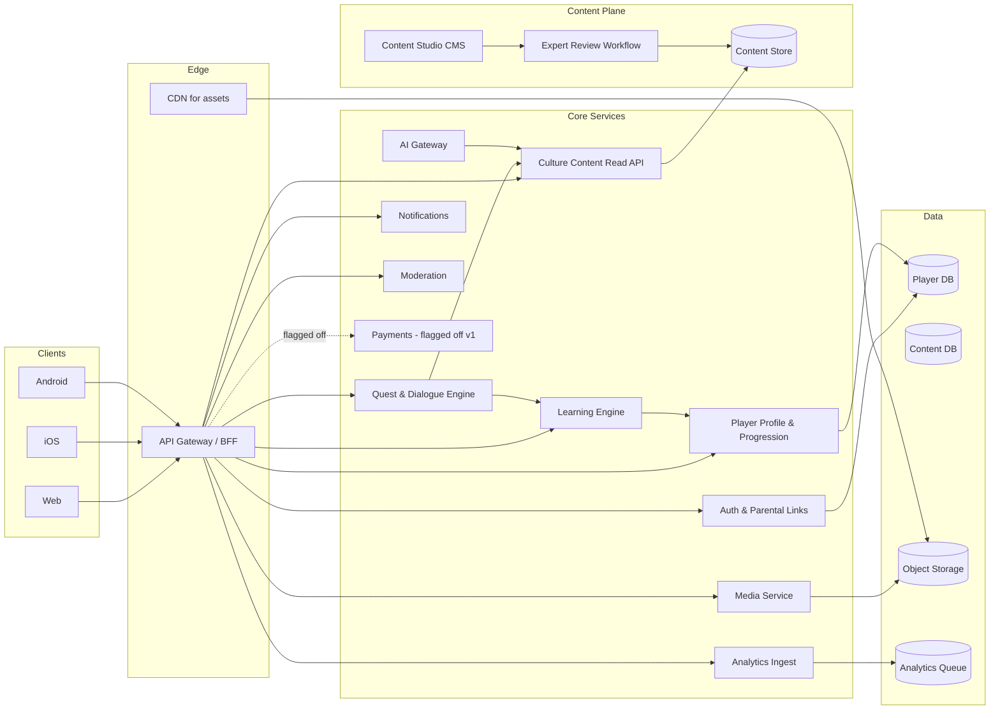
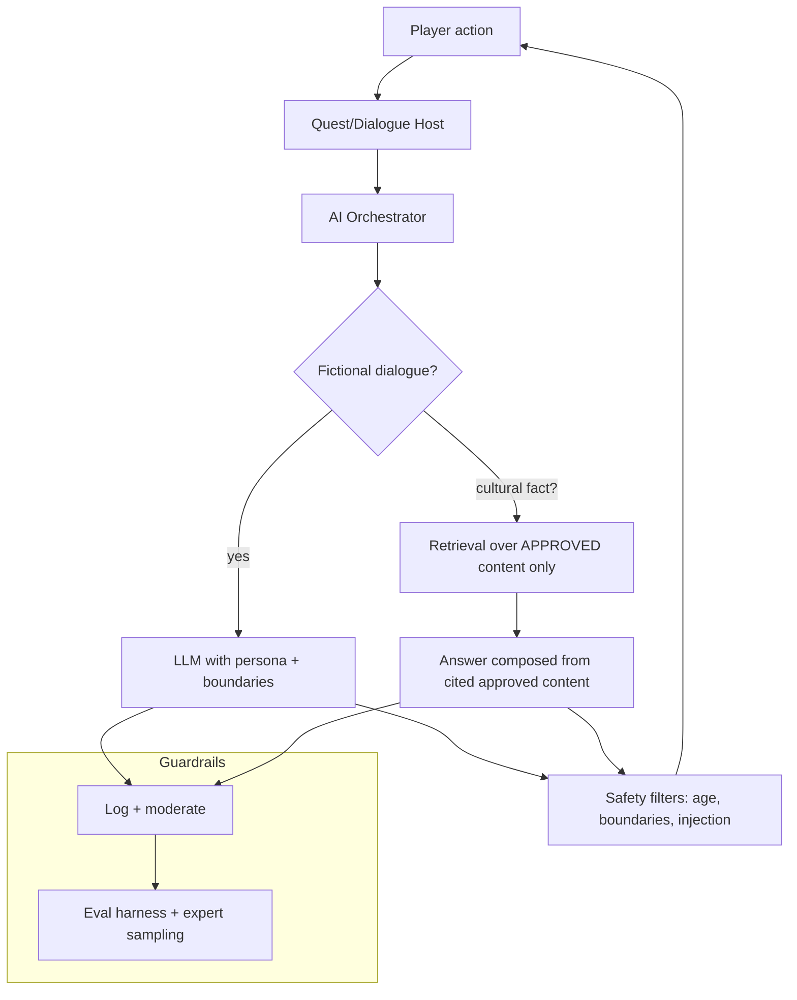
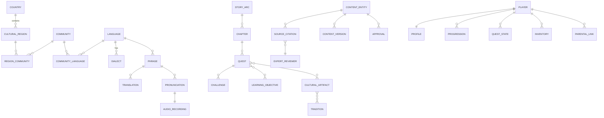

# Culture Kingdom — Phase 0 Technical Blueprint

**Source:** `Culture_Kingdom_Master_Prompts_revised.md` (v1.1, audited/revised)
**Scope:** Phase 0 deliverable — product analysis, ambiguities, technical risks, and the complete technical blueprint. **No implementation code.**
**Recommended reading order honored:** Phase 13 (Testing), Phase 14 (Globalization), and Phase 15 (Security & Child Safety) strategies are sketched at blueprint level here (§10–§12) so Build Sprints 17 and 19 can execute against them later.

---

## 1. Product Analysis

### 1.1 What is being built

A story-driven educational adventure game where **language is a game mechanic, culture is the game world, story is the motivation, quests are the delivery system, and discovery is the reward**. Nigeria is the first content ecosystem; the platform must be global from day one.

### 1.2 The single hardest design constraint

> **Do not build Nigeria into the engine. Build a global engine and put Nigeria into it first.**

Every architectural decision below is evaluated against this rule. If adding France, Japan, or Brazil requires touching core engine code, the architecture has failed.

### 1.3 What the product actually is (decomposed)

| Sub-product | Nature | Change cadence |
|---|---|---|
| **Game engine** (quest/dialogue/progression/reward loops) | Reusable infrastructure | Slow — changes with gameplay design |
| **Learning engine** (mastery model, spaced repetition, challenge delivery) | Reusable infrastructure | Slow |
| **Culture/content engine** (regions, NPCs, artifacts, stories) | Data + rendering contracts | Fast — grows per culture pack |
| **Content pipeline** (CMS, review, publication) | Reusable infrastructure | Slow |
| **AI services** (NPC dialogue, hints, pronunciation feedback) | Infrastructure + per-language config | Medium |
| **Analytics, admin, moderation, parental controls** | Reusable infrastructure | Slow |

**Rule:** anything specific to Yoruba/Igbo/Hausa must exist as content/configuration; anything that should be unchanged when adding a country is infrastructure.

### 1.4 Core loop (from the spec)

Explore → Meet characters → Communicate → Discover culture → Complete quest → Learn → Earn rewards → Unlock region → Face harder challenges → Recover a Voice → Expand the world.

The blueprint must make every arrow in this loop **data-driven**: each step reads its behavior from content, never from engine conditionals.

---

## 2. Ambiguities Identified (and Resolutions)

| # | Ambiguity in the spec | Resolution for the blueprint |
|---|---|---|
| A1 | Hierarchical content model (World→Country→…→Artifact) vs. many-to-many reality (languages span communities, regions overlap, diaspora exists) | **Graph-of-content with typed many-to-many relations**, not a strict tree. Hierarchy is a *view* (projection) over the graph, not the storage shape. See §4. |
| A2 | "Players" include children — but no age-gating detail given | Assume minors by default. Parental controls, data minimization, and COPPA/NDPA/GDPR-K posture are **core**, not a phase-15 afterthought. Age band is a first-class profile field. |
| A3 | Multiplayer/social is listed in Phase 1 item 22 but never revisited | Declared **out of scope for v1** (per the doc's own instruction). Architecture reserves a social/presence boundary in the API but builds nothing. |
| A4 | AI "must not invent cultural facts" — but NPCs need to converse | Strict split: **fictional dialogue** (AI-permitted, sandboxed) vs **cultural facts** (RAG-only from approved content, human-reviewed before publication). See §7. |
| A5 | "Content Pack" is named as the expansion unit but never defined | Defined here: a versioned, installable bundle of structured content + assets + language data + config, loaded by the engine without code change. See §5. |
| A6 | Payment model "future" but Phase 3 includes Subscriptions/Purchases | Schema included now (Build Sprint 20 needs it), **feature-flagged off**; no payment logic gates learning content. |
| A7 | Offline/poor-network behavior (Phase 13 mentions testing poor network) | Blueprint includes an offline-tolerant client cache strategy; exact sync semantics deferred to implementation. |
| A8 | Audio licensing, speaker consent, and attribution are mentioned but not specified | Recording metadata includes license + consent fields; contributor workflow requires explicit license selection. |
| A9 | Leaderboards named but social is out of scope for v1 | Leaderboard tables exist in schema; **feature-flagged off** in v1 (no social surface for minors). |
| A10 | "Cultural Guardian Level" ranks are listed but XP→rank mapping is not | Blueprint defines a monotonic, content-independent XP→rank curve in the progression engine; tuning values are config, not code. |

---

## 3. Technical Risks

| # | Risk | Severity | Mitigation |
|---|---|---|---|
| R1 | **Cultural content quality/authenticity** — wrong or offensive facts destroy trust irrecoverably | Critical | Mandatory source attribution + expert review workflow; publication requires explicit approval; AI never publishes facts unreviewed (§7). |
| R2 | **Engine hardcoding** — `if language == Yoruba` creeping into core | Critical | The Critical Development Rule is enforced by review + a lint/architecture test: content data lives in the content store, engine reads by ID. Culture Packs are data-only. |
| R3 | **Child-safety / privacy compliance** (COPPA, GDPR-K, NDPA 2023) | Critical | Data minimization by default; parental consent flow; no free-text social surface in v1; age band gating; audit logging. |
| R4 | **Audio sourcing for endangered languages** — no TTS quality; native speakers needed | High | Contributor pipeline with consent/license metadata; synthetic voice only as fallback, flagged; never sole source for culturally sensitive languages. |
| R5 | **Scope explosion** — 10 Nigerian languages × deep content is enormous | High | Phase 5 mandates smallest meaningful MVP; depth over breadth; content pipeline must make the *second* language cheaper than the first. |
| R6 | **AI hallucination in NPC dialogue** leaking wrong cultural facts | High | RAG restricted to approved content; strict conversation boundaries for child-facing NPCs; evaluation harness + expert sampling. |
| R7 | **Cross-platform scope** (web/iOS/Android) from day one | Medium | Platform-independent backend API; client is a thin shell; avoid native-only features in core. |
| R8 | **Many-to-many content model complexity** (languages↔communities↔regions) | Medium | Explicit join entities with semantic roles; hierarchy is a projection, not storage. |
| R9 | **Content versioning/approval workflow complexity** | Medium | Simple linear state machine (draft→review→expert review→approved→published→archived) with audit trail; no branching merges in v1. |
| R10 | **Payments coupling to learning** | Medium | Payments schema present but feature-flagged; hard rule: payment never gates essential language content. |
| R11 | **Pronunciation scoring accuracy** for tonal/under-resourced languages | Medium | Defer speech recognition; design provider-agnostic interface; human-verified audio is the primary teaching artifact. |
| R12 | **Observability gaps** masking learning-impact regressions | Low | Analytics events defined alongside game events from Sprint 1; quest-completion and mastery funnels are first-class metrics. |

---

## 4. Domain Architecture

### 4.1 Global systems (infrastructure — unchanged per country)

- Identity & access (authn/authz, parental links, roles)
- Progression engine (XP, ranks, streaks — content-independent math)
- Quest/dialogue/story **engines** (execute content, contain no content)
- Content pipeline (CMS, versioning, review workflow, publication)
- Localization/i18n (UI strings, locale formats, RTL)
- Media/asset service (audio, images, video; CDN-backed)
- AI gateway (prompt orchestration, RAG over approved content, safety filters)
- Analytics ingestion, notification service, moderation service
- Payment service (flagged off in v1)

### 4.2 Content data (per-culture, installable)

- Countries, cultural regions, communities, languages, dialects, scripts
- Vocabulary, phrases, translations, pronunciations, audio recordings
- Story arcs, chapters, quests, challenges, learning objectives
- Cultural artifacts, traditions, festivals, foods, clothing, music, historical notes
- Sources, expert reviewers, approvals, versions
- Region/NPC/quest configuration binding content to game locations

### 4.3 Content graph (resolves ambiguity A1)

Storage is a **typed graph of content entities with many-to-many relations**, not a tree:

```
Country ──(has_many)──> CulturalRegion
CulturalRegion ──(m:n)──> Community
Community ──(m:n)──> Language
Language ──(has_many)──> Dialect/Script variants
Language ──(has_many)──> Vocabulary/Phrase
Phrase ──(has_many)──> Translation (per UI locale)
Phrase ──(has_many)──> Pronunciation/Audio
StoryArc ──(has_many)──> Chapter ──(has_many)──> Quest ──(has_many)──> Challenge
Quest ──(m:n)──> LearningObjective
Quest/Challenge ──(m:n)──> CulturalArtifact
CulturalArtifact ──(m:n)──> Tradition/Festival/Food/Clothing/Music
* ──(has_many)──> Source ──(belongs_to)──> ExpertReviewer ──> Approval
```

The "World → Country → Region → …" hierarchy of the spec is exposed as a **query projection** (e.g., a region's primary language, its default story arc) while storage keeps the m:n truth. Examples of why: Yoruba spans Nigeria/Benin/diaspora; Hausa spans multiple countries; a festival can be shared by adjacent regions.

---

## 5. Culture Pack (resolves ambiguity A5)

A **Culture Pack** is a versioned, installable bundle:

```
culture-pack/<pack-id>/<version>/
  manifest.json          # pack id, version, engine compatibility range
  countries/*.json
  regions/*.json
  communities/*.json
  languages/*.json       # incl. dialects, scripts, orthography notes
  vocabulary/*.json      # phrases, translations, pronunciation refs
  stories/*.json
  quests/*.json
  characters/*.json
  artifacts/*.json
  sources/*.json
  audio/<locale>/*.mp3   # + metadata sidecars (license, speaker, quality)
  i18n/<ui-locale>.json  # UI strings for in-pack surfaces
  config.json            # feature flags, difficulty tuning, region unlocks
```

**Install contract:** the engine validates the manifest against its compatibility range, imports content through the CMS review workflow (draft → expert review → approved → published), and serves it. **Zero engine code changes.** Uninstall/rollback = content version pinning.

---

## 6. System & API Architecture

### 6.1 System diagram (Mermaid)



### 6.2 API architecture (shape, not exhaustive spec)

- **REST/JSON, versioned** (`/v1/...`), BFF-per-platform optional.
- **Player APIs:** profile, progression, quest state, inventory, notifications.
- **Content read APIs:** regions, NPCs, quests, vocabulary — all parameterized by content IDs; no cultural conditionals.
- **Content write APIs:** CMS-only, role-gated, audit-logged.
- **AI APIs:** server-side only; client never holds model keys.
- **Idempotency keys** on progression/reward mutations (mobile retry safety).
- **Cursor pagination** on all content lists.

### 6.3 Cross-cutting

- **Authn:** OIDC-based; anonymous play with upgrade path (needed for kids without accounts); parental link relation.
- **Authz:** RBAC for CMS (content creator, language expert, cultural expert, historian, translator, reviewer, admin); player-scoped access for game APIs.
- **Caching:** CDN for immutable published content; short-TTL cache for player state; content version pinning per client session.
- **Observability:** structured logs, traces on quest/learning flows, metrics for the Phase 16 success metrics (learning, mastery, return).
- **Deployment:** containerized services; content packs deployed via CMS publication, decoupled from service deploys.

---

## 7. AI Architecture (resolves ambiguity A4, risk R6)



**Hard rules:**
1. Cultural **facts** are served only from approved, cited content (RAG over the content store). The model never asserts unreviewed facts.
2. Fictional NPC dialogue is permitted but runs behind age-appropriate safety filters and strict conversation boundaries (no PII solicitation, no unsafe topics).
3. Every AI-assisted *content-creation* draft enters the normal review workflow; AI never publishes.
4. Evaluation: golden-set regression on cultural accuracy + red-team prompts for child safety; expert sampling per language.

---

## 8. Database Architecture (blueprint level; Phase 3 details the schema)

- **Two planes:** player-state DB (mutable, per-player) and content DB (versioned, publication-gated).
- **Content versioning:** published content is immutable; edits create new versions; clients pin a version for session consistency.
- **Soft deletion** (`deleted_at`) + audit fields (`created_at/updated_at/created_by`) on all content and player entities.
- **m:n joins** carry semantic attributes (e.g., `community_languages` with `is_primary`, `region_communities` with `overlap_note`).
- **Migrations:** forward-only, expand-then-contract; content packs add rows, never columns.

### ERD sketch (Mermaid, core entities)



---

## 9. UX/UI Architecture (blueprint level)

- Mobile-first; design tokens (color/type/spacing) defined once, themed per culture pack **within** accessibility contrast rules.
- Screen map per Phase 4 (27 screens); component library with feedback/loading/empty/error states.
- i18n-ready: text expansion, RTL, non-Latin scripts, locale formats.
- Authentic cultural references with documented sources; no generic "African" stereotypes.
- Complete journeys specified: new player → first quest → first language mastery → first region completion.

---

## 10. Testing Strategy (Phase 13 sketch — Build Sprint 17 executes this)

- **Unit:** progression math, mastery model, quest state machine, content validation.
- **Integration:** auth flows, content publication pipeline, quest execution against a sample pack.
- **E2E:** the four player journeys; add-French/add-Japanese/add-Arabic expansion tests proving **zero engine change**.
- **Human/content validation:** cultural expert sign-off checklist per pack; pronunciation review.
- **Non-functional:** RTL layouts, long translated strings, poor network, accessibility (WCAG AA), child-safety boundary probes.
- **Failure posture:** incomplete/unverified content must fail safe (not render) rather than render wrong.

---

## 11. Globalization Strategy (Phase 14 sketch)

- **Culture Pack** pipeline (§5) is the expansion mechanism.
- Introduction process: research → cultural consultation → content creation → language validation → translation → audio recording → game design → expert review → QA → localization → publication → monitoring.
- Explicit handling for diaspora, minority/endangered languages, dialects, RTL, non-Latin scripts, historical cultures.

---

## 12. Security & Child Safety (Phase 15 sketch — Build Sprint 19 executes this)

- Threat model: account takeover, data exposure, injection, XP/leaderboard manipulation, payment abuse, AI/chat abuse, privacy violations.
- Mitigations: RBAC, rate limiting, audit logging, encrypted transport & at-rest, parental controls, safe defaults, content moderation, reporting flows, data retention/deletion.
- Child-safety hard rules: no social free-text in v1; AI NPCs never solicit PII; parental consent + controls; age-appropriate defaults.
- **v1 feature flags OFF:** social/leaderboards (schema exists), payments (schema exists).

---

## 13. Most Dangerous Architectural Mistakes (per Phase 2 requirement)

1. **Hardcoding culture/language conditionals in the engine** — kills expansion (R2).
2. **Tree-only content model** — cannot express overlapping regions, diaspora, multi-language communities (A1).
3. **Mutating published content in place** — breaks client version pinning and expert audit trail.
4. **Coupling learning integrity to payments** — paywalls essential concepts (A6/R10).
5. **Client-side cultural logic** — any `if culture` in clients multiplies per-platform drift.
6. **AI as source of truth for cultural facts** — trust destruction (R1/R6).
7. **Skipping the CMS review workflow** — no expert gate means no authenticity guarantee (R1).
8. **Per-platform business logic** — backend must stay platform-independent (R7).

---

## 14. Implementation Posture (feeds Phase 12)

- Vertical slices (Build Sprints 1–21), each fully functional and tested before the next.
- Strategy documents (Testing, Globalization, Security) drafted immediately after Phase 2 approval — before Build Sprints 17/19.
- No fake functionality: unavailable external services get documented abstractions.
- Every sprint ends with: completed work, files changed, tests, known limitations, next phase.

---

## 15. Open Items for Phase 1 (GDD)

- XP→rank curve values (config, not code — A10).
- Multiplayer/social: **explicitly out of scope for v1** (A3).
- MVP scope recommendation is Phase 5's deliverable; blueprint assumes the smallest meaningful pack.
