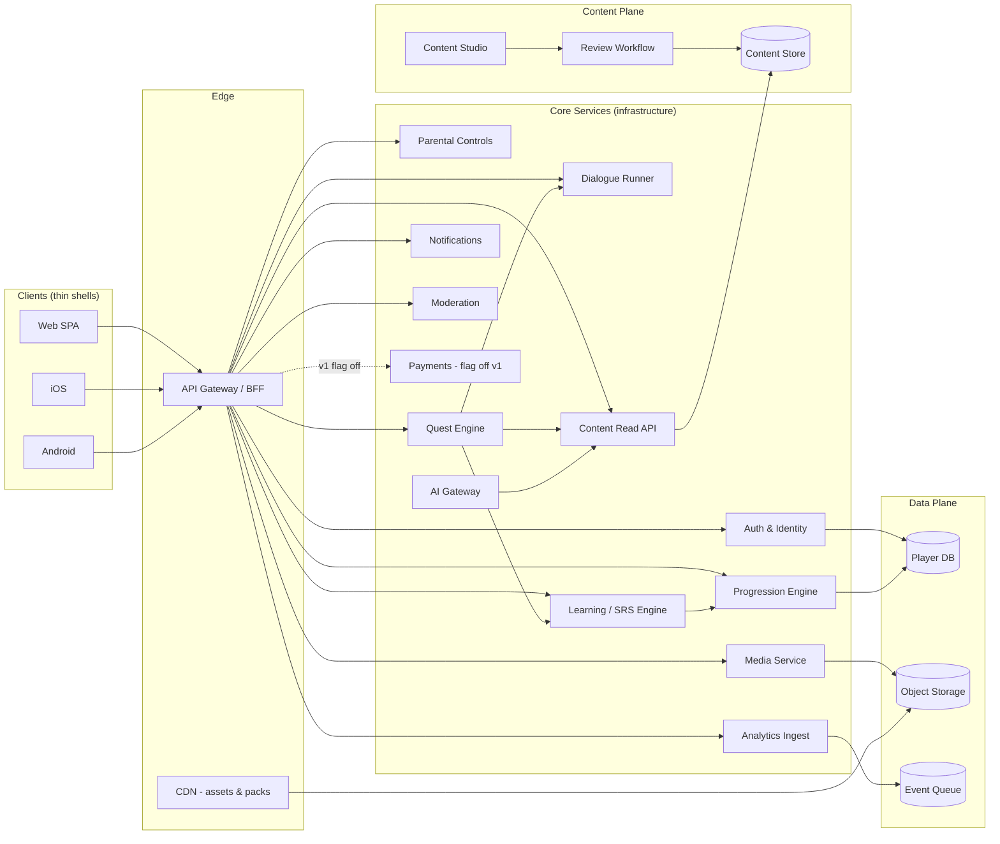
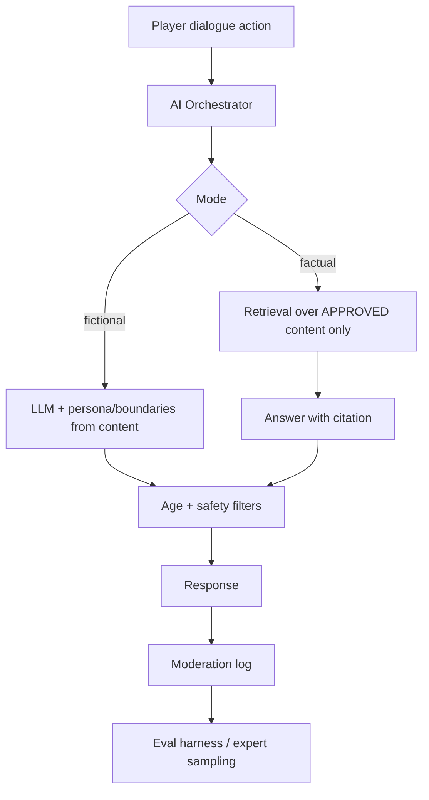

# Culture Kingdom — Phase 2: Global Architecture

**Upstream:** Phase 0 Blueprint, Phase 1 GDD.
**Critical rule enforced:** the engine is global; Nigeria is the first content pack. No `if country == Nigeria` anywhere in engine code.

---

## 1. System Architecture



**Global systems vs content data (the load-bearing distinction):**

| Global system (infrastructure, never per-culture) | Content data (per-culture pack) |
|---|---|
| Auth, parental controls, RBAC | Countries, regions, communities |
| Progression math, rank curve | Languages, dialects, scripts |
| Quest/dialogue/story engines | Quests, dialogues, story arcs |
| Learning/SRS engine | Vocabulary, phrases, translations |
| CMS + review workflow | Sources, reviewers, approvals |
| Media service, CDN | Audio, images, patterns |
| AI gateway + safety filters | NPC personas, dialogue trees |
| Analytics, notifications, moderation | Cultural artifacts, festivals |
| Payments (flagged off v1) | Region configs, unlock rules |

---

## 2. Domain Architecture

Bounded contexts (services own their data; communicate via APIs/events):

1. **Identity** — accounts, profiles, parental links, consent, roles.
2. **Progression** — XP tracks, ranks, mastery state, streaks.
3. **Quest/Story** — quest state machine, objective evaluation, dialogue execution.
4. **Learning** — SRS scheduling, mastery stages, challenge selection.
5. **Content** — content store, versioning, publication, read APIs.
6. **Media** — asset upload, transcoding, signed URLs.
7. **AI** — orchestrator, RAG over approved content, safety filters, eval.
8. **Analytics** — event ingestion, funnels, learning metrics.
9. **Moderation** — report intake, review queue, actions.
10. **Commerce** — subscriptions/purchases (flagged off v1).

**Event backbone:** domain events (`QuestCompleted`, `PhraseReviewed`, `VoiceRecovered`, `ContentPublished`) on a queue; analytics and notifications subscribe.

---

## 3. Database ERD (core)

```mermaid
erDiagram
  COUNTRY ||--o{ CULTURAL_REGION : contains
  CULTURAL_REGION ||--o{ REGION_COMMUNITY : ""
  COMMUNITY ||--o{ REGION_COMMUNITY : ""
  COMMUNITY ||--o{ COMMUNITY_LANGUAGE : ""
  LANGUAGE ||--o{ COMMUNITY_LANGUAGE : ""
  LANGUAGE ||--o{ DIALECT : has
  LANGUAGE ||--o{ SCRIPT : uses
  LANGUAGE ||--o{ PHRASE : ""
  PHRASE ||--o{ TRANSLATION : ""
  PHRASE ||--o{ PRONUNCIATION : ""
  PRONUNCIATION ||--|| AUDIO_RECORDING : ""
  PHRASE }o--o{ LEARNING_OBJECTIVE : ""
  STORY_ARC ||--o{ CHAPTER : ""
  CHAPTER ||--o{ QUEST : ""
  QUEST ||--o{ QUEST_STEP : ""
  QUEST_STEP ||--o{ CHALLENGE : ""
  QUEST }o--o{ CULTURAL_ARTIFACT : references
  CULTURAL_ARTIFACT }o--o{ TRADITION : relates
  CULTURAL_ARTIFACT }o--o{ FESTIVAL : relates
  CONTENT_ENTITY ||--o{ SOURCE_CITATION : cites
  SOURCE_CITATION }o|| EXPERT_REVIEWER : reviewed_by
  CONTENT_ENTITY ||--o{ CONTENT_VERSION : versions
  CONTENT_ENTITY ||--o{ CONTENT_APPROVAL : approvals
  PLAYER ||--|| PROFILE : has
  PLAYER ||--o{ PROGRESSION : earns
  PLAYER ||--o{ PHRASE_MASTERY : tracks
  PLAYER ||--o{ QUEST_STATE : ""
  PLAYER ||--o{ INVENTORY_ITEM : owns
  PLAYER ||--o{ PARENTAL_LINK : guarded_by
  PLAYER ||--o{ CONSENT : grants
```

**Key m:n joins with semantics:**
- `COMMUNITY_LANGUAGE(is_primary, register_notes)` — a community may use several languages; a language spans communities.
- `REGION_COMMUNITY(overlap_note, era)` — regions overlap; diaspora/historical cultures don't fit political borders.
- `QUEST_LEARNING_OBJECTIVE(weight)` — quests teach multiple objectives with weights.

---

## 4. Database Design Decisions (Phase 3 schema blueprint)

- **Two planes:** player DB (mutable) and content DB (immutable published versions). Clients pin content versions per session.
- **Versioning:** every content entity has `CONTENT_VERSION` rows; published versions are immutable; edits create new versions; approval gates promotion.
- **Soft deletion:** `deleted_at` on all entities; content "retirement" is a publication state, not a delete.
- **Audit fields:** `created_at/by, updated_at/by` everywhere; `CONTENT_APPROVAL` is the expert-review audit trail.
- **m:n joins** carry semantic attributes (see §3).
- **Adding a country/language = inserting rows in a new Culture Pack. Zero schema migration.**
- **Enums:** `content_status(draft, review, expert_review, approved, published, archived)`, `mastery_stage(introduced, encountered, practiced, understood, recalled, mastered)`, `quest_state(locked, available, active, completed, failed)`, `age_band(under_8, 8_12, 13_17, 18_plus)`.
- **Indexes:** content lookups by `(pack_id, entity_type, status, published_version)`; player lookups by `(player_id, entity)`; SRS by `(player_id, due_at)`.
- **Subscriptions/Purchases tables exist** (Build Sprint 20), feature-flagged off; no payment gate on learning content.

---

## 5. API Architecture

- REST/JSON, versioned `/v1`; BFF optional per platform.
- **Player APIs:** `POST /v1/players`, `GET /v1/me/progression`, `POST /v1/quests/{id}/steps/{n}/complete`, `GET /v1/me/srs/due`.
- **Content read APIs:** `GET /v1/packs/{packId}/regions`, `GET /v1/regions/{id}/npcs`, `GET /v1/quests/{id}` — all by ID, no cultural conditionals; responses carry `content_version`.
- **CMS APIs:** role-gated CRUD + workflow transitions (`POST /v1/cms/content/{id}/submit-review`).
- **AI APIs:** server-side only; `POST /v1/ai/dialogue` with persona + boundary config from content.
- **Idempotency keys** on all progression/reward mutations. Cursor pagination on lists.
- **Auth:** OIDC; anonymous-play with upgrade path; parental consent flow for minors.

---

## 6. Content Pipeline

```
Author (CMS) → Draft → Peer/Language review → Expert review → Approved → Published (immutable version) → CDN/Read API
                                                    ↑ rollback: pin previous version
```

- Culture Packs are authored in CMS, validated against manifest schema, then published as a versioned bundle.
- Bulk import/export (JSON) for large libraries.
- Every factual content item carries: source, owner, reviewer, review status, version, publication status.

---

## 7. AI Architecture



Rules: cultural facts only from approved RAG; fictional dialogue behind child-safety filters; AI-generated content drafts enter CMS review; eval harness with golden sets + red-team prompts; per-language expert sampling.

---

## 8. Authentication & Deployment Architecture

- **Authn:** OIDC / OAuth2; anonymous session with upgrade; parental consent gating for minors; JWT access + rotating refresh.
- **Authz:** player-scoped for game APIs; RBAC for CMS; service-to-service via mTLS/signed tokens.
- **Deployment:** containerized services behind API gateway; content packs deployed via CMS publication (decoupled from service releases); CDN for immutable assets; blue/green for services; feature flags for payments/social.
- **Observability:** structured logs, traces on quest/learning flows, metrics for the Phase 16 success metrics; analytics via event queue.

---

## 9. Most Dangerous Architectural Mistakes (from Phase 0 §13, restated as review gates)

1. Culture/language conditionals in engine code → expansion dies.
2. Tree-only content model → can't express overlap/diaspora.
3. Mutating published content in place → breaks version pinning/audit.
4. Payments gating learning content.
5. Client-side cultural logic.
6. AI as source of truth for cultural facts.
7. No expert review gate.
8. Per-platform business logic.

Each of these is a **review-gate rejection criterion** in every Build Sprint.
