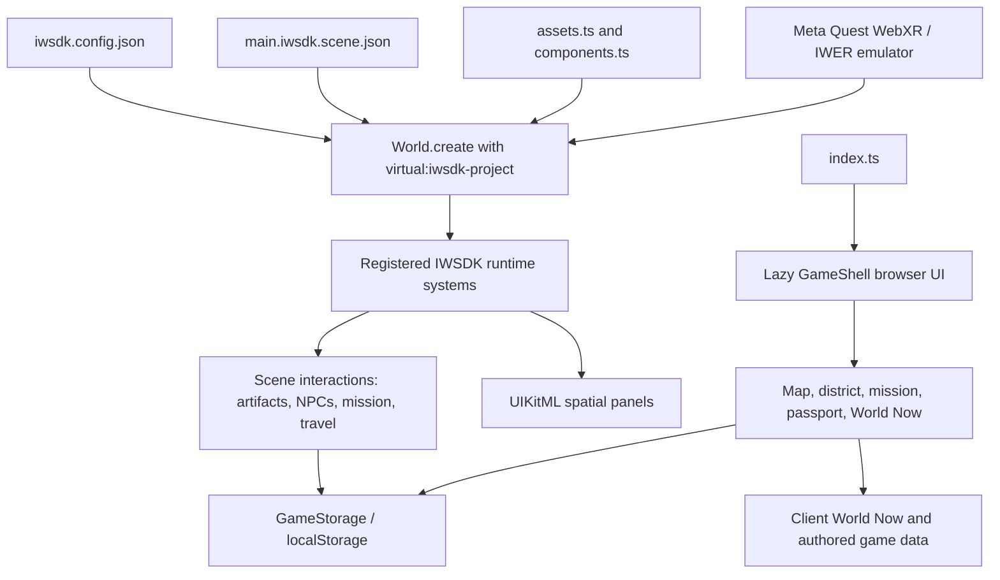

# Advenquo master product audit

Audit date: 5 November 2026. This is a source and test audit of the current repository, not a claim that the full product vision is already implemented.

## A. Current architecture

The active immersive experience is an IWSDK 1.0.1 TypeScript app. IWSDK’s entity-component system (ECS) stores scene entities and their data in components; registered systems react to those components. `iwsdk.config.json` selects the scene, manifest modules, and WebXR configuration. `src/index.ts` creates the world from the virtual project module, registers the runtime systems, and lazy-loads `src/game/game-shell.ts` for the map and browser interface.

The active scene is a single authored scene whose `LocationAnchor` groups are shown or hidden by `WorldStreamingSystem`; travel moves the player to a destination spawn. The browser “open world” data and the active spatial world therefore describe more destinations than are currently connected as walkable spaces.

There are two overlapping layers in source: the registered IWSDK gameplay systems and a larger set of singleton managers under `src/systems/`. The latter contain useful authored models and logic, but most are not registered in `src/index.ts`. Do not treat their existence or unit tests as proof that they participate in runtime gameplay. The Tobi story is currently routed through `AdventureMissionSystem` and the existing `NpcDialogueSystem`; `missionEngine` remains a separate path for authored browser missions and other NPC dialogues.

## B. Feature inventory

| Feature | Status | Evidence and limit |
|---|---|---|
| IWSDK, TypeScript, Vite, UIKitML, WebXR | Implemented | Project config and package manifest; strict TypeScript check passes. |
| Market environment and four artifact discoveries | Implemented and tested | Authored scene, `DiscoverySystem`, spatial fact panels, and unit tests. Full first-time usability is not established by tests. |
| Hands-first input and grabbing | Implemented; emulator evidence exists | Hand tracking and pinch-grab are enabled. Earlier IWER evidence recorded a tracked-hand grab/release without controllers. This is not a physical Quest test or proof of all interactions. |
| Tobi / Iyá Missing Shipment route | Implemented; partially runtime-verified | Tobi is placed in the market; mission dialogue, clues, receipt, crate, return decision, and save state use existing systems. Earlier IWER inspection confirmed Tobi’s opening panel and choices. The entire route has not been played through end to end. |
| Free exploration and postponing Tobi | Implemented in this audit; unit-tested, runtime UI not verified | Exploration mode is saved, defaults to free exploration, hides the mission tracker, and Tobi offers a “later” response. The live browser command timed out during this audit, so no visual runtime claim is made for this change. |
| Location navigation | Partial | Four location IDs, map data, anchors, environment descriptions, and travel controls exist. Runtime travel primarily toggles visibility and teleports; it is not a continuous connected city or functioning vehicle ride. |
| Everyday activities | Partial / mostly interface and authored scenarios | Cultural inspection and the shipment investigation are interactive. The market does not yet implement a repeatable shopping, bargaining, pricing, purchase, and transaction loop. Transport interactions do not provide a complete ride/fare/arrival loop. |
| NPC identities and schedules | Partial | Profiles, routines, animation and memory modules exist. Some logic is data-driven or unit-tested but is not part of the registered scene runtime. There is no demonstrated city-wide schedule simulation. |
| Open-ended AI conversation | Not integrated | `ConversationalAISystem` constructs persona prompts but `converse()` returns authored deterministic responses. No model provider, server API, or client-to-model call is configured. This is a useful offline fallback, not LLM-backed NPC AI. |
| World Now | Prototype / partially implemented | Curated stories, ingestion adapters, normalization, editorial workflow and verification types exist. `WorldEngineApi` is an in-memory client-side facade, not a deployed API service. Seed/mock content and dated claims require source and freshness review before publication as current information. |
| Persistence | Partial | Main profile, discoveries, mission and new exploration preference use browser localStorage with in-memory fallback. Storage is schema version 1, has no migration pipeline or account synchronization, and NPC memory uses a separate localStorage key. |
| Desktop / responsive UI | Implemented in source; not comprehensively usability-tested | DOM shell, keyboard/mouse and touch handlers exist alongside spatial UI. The active runtime UI was not available for a fresh end-to-end check during this audit. |
| Hosting / release | Missing from repository | No deployment manifest, backend service, hosted URL, Quest package, or release evidence was found in the inspected files. |
| Quest performance | Unverified | No physical-device frame-time, memory, GPU, or CPU profile is present. Do not infer target FPS from the browser or IWER. |
| Asset rights and cultural review | Incomplete | Project code and some assets are original/procedural and a font license is bundled. A complete asset provenance, attribution, and cultural review has not been performed. |

## C. Technology, dependencies, and services

- Runtime: `@iwsdk/core` 1.0.1, Three.js r181 through the `super-three` alias, WebXR, and IWER for browser emulation.
- UI: `@pmndrs/uikit`, Horizon UIKit, UIKitML; ordinary DOM/CSS for the browser shell.
- Build and language: Vite 7.3.7, TypeScript 5.x, `tsx` test runner.
- Tests: Node test runner across 15 test files (29 suites at this audit); no separate browser automation package is declared in the application dependencies.
- Content: TypeScript data modules, scene JSON, UIKitML, and procedural TypeScript assets.
- External services: no AI vendor SDK, authentication provider, application backend, database, analytics service, or deployment configuration was found. RSS/JSON source adapters call external URLs directly through browser `fetch`; production CORS, timeouts, source reliability, and secret handling are not provided by a server boundary.

## D. Architecture gaps and technical risks

1. **Runtime reachability is the main risk.** Many systems and services exist only as source modules or are invoked by tests. Keep a clear inventory of what `src/index.ts` actually registers and what the active scene instantiates.
2. **Parallel progression and dialogue owners can drift.** `AdventureMissionSystem`, `missionEngine`/`MissionManager`, `StoryEngine`, `DialogueManager`, and `ConversationalAISystem` overlap. The Tobi route now uses one active path, but character memory and the longer authored Tobi arc are not unified with that route.
3. **Location data overstates simulation.** Map entries and authored destinations do not by themselves make connected or functional destinations. Travel currently behaves as a location switch/teleport.
4. **World Now is not a production news service.** Ingestion and editorial components are in-memory/client-side prototypes; source freshness and the seeded examples need independent verification, dates, editorial handling, and expiry before public use.
5. **Save evolution is fragile.** `localStorage` provides persistence on one browser, but there is no migration/version upgrade flow or cross-device account. The new exploration preference remains backward-compatible by falling back when older saves omit it.
6. **Large initial runtime bundle.** The latest production build emitted an approximately 6.89 MB minified entry chunk (1.77 MB gzip), plus a 2.09 MB Havok WebAssembly file. This is a material Quest load-time and memory risk until profiled and split by dependency graph.
7. **Yoruba font coverage remains unresolved.** The build still reports missing glyphs in the dialogue and navigation UIKitML font atlas, despite a bundled Noto Sans Yoruba file. Verify atlas application and rendered glyphs in runtime.
8. **Automated acceptance is not hardware evidence.** Unit tests cover authored systems and data contracts but do not prove a complete hands-only route, seated comfort, physical Quest performance, live source accuracy, or first-session usability.

## E. Recommended architecture and implementation sequence

Keep the current IWSDK / WebXR stack. It supports the established hands-first scene and there is no measured requirement that justifies an engine migration. Consolidate gradually around clear owners rather than rewriting the engine:

1. **Close the active-loop acceptance gap.** Add an end-to-end test for the registered Missing Shipment route: optional start/postpone, Iyá clue, drum/receipt, crate, Tobi decision, save/restore. Verify hand ray and seated navigation in IWER, then repeat on a physical Quest before claiming device support.
2. **Ship one real market activity.** Extend the existing trader and item interactions into one complete buy/bargain loop with authored prices, deterministic outcomes, and a persisted transaction/inventory result. Do not create a generic economy framework ahead of this slice.
3. **Make one genuine transit connection.** Connect the market and Yaba through a player-controlled Danfo boarding, route, fare, and arrival interaction. Keep destinations labelled as previews until their environments and routes are playable.
4. **Consolidate runtime state ownership.** Decide the authoritative owner for dialogue/story, adventure progression, NPC memory, and world travel. Port or connect one capability at a time, retaining deterministic authored fallbacks and existing scene IDs.
5. **Embed language learning in interactions.** Add opt-in pronunciation/translation assistance and track only useful vocabulary progress; verify Yoruba glyphs and audio on the actual runtime.
6. **Harden World Now before expansion.** Move retrieval behind a server boundary, validate external payloads, retain citations and verification timestamps, enforce expiry/corrections, and keep it out of the critical game path when unavailable.
7. **Profile and release.** Split the large Quest startup path, measure frame/memory/load on a physical headset, audit asset licenses and cultural claims, then deploy HTTPS and capture a real gameplay demonstration.

Do not start a global map expansion, autonomous crowd AI, live LLM dialogue, or multiple lifestyle activities until the first market and transit loops have runtime acceptance tests.

## F. Preservation and acceptance plan

Preserve the established market scene and authored IDs, hand-ray and pinch interactions, artifact discovery/fact cards, existing NPCs, location switching, browser controls, and save/progression behavior. Keep gameplay logic deterministic and continue supporting gameplay when external information or future AI services are unavailable.

For the first activity slice, acceptance should require: the player can enter free exploration without a compulsory mission tracker; the player can postpone Tobi and later accept the story; market trading changes a visible inventory or transaction result; the state survives reload; mouse/touch and tracked-hand interaction remain available; and no unrelated map, artifact, or save behavior regresses.

## Audit implementation and verification

- Inspected: `package.json`, `iwsdk.config.json`, `tsconfig.json`, `vite.config.ts`, `README.md`, `src/index.ts`, active scene and UI, mission/storage/domain types, NPC/dialogue/story/memory modules, world/location data, World Now content and ingestion modules, test inventory, and deployment/config file inventory.
- Updated `tests/cinematic-realism.test.ts` so it continues to assert Tobi is in the active market while the urban-scene checks still validate the architect studio, construction site, restaurant, street infrastructure, and contractor.
- First player-facing slice: persisted `explorationMode` (default `free_exploration`), made the spatial objective/action prompt reflect the saved mode, and added Tobi’s “I’d like to explore first” response without advancing the mission.
- `npm run --if-present typecheck`: passed.
- `npm test`: **122 passed, 0 failed** (29 suites).
- `npm run build`: passed. Warnings remain for UIKitML glyph coverage, Rollup annotations in Zod, and a chunk larger than 500 kB.
- Runtime UI check: the managed-browser snapshot timed out; the new free-exploration default and postponement response are not claimed as visually or end-to-end verified in this audit. Earlier IWER evidence for Tobi’s opening predates this audit change. Physical Quest and performance checks remain outstanding.
